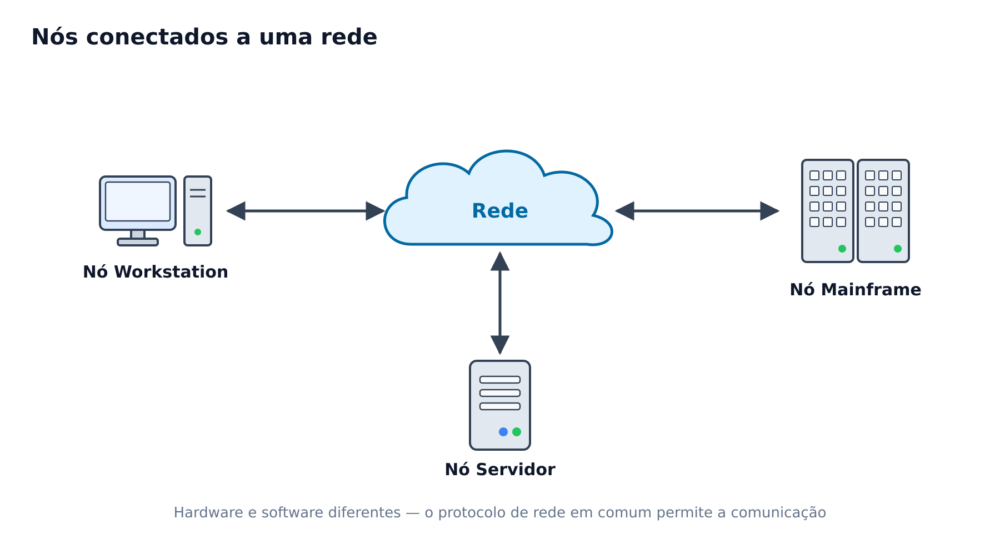
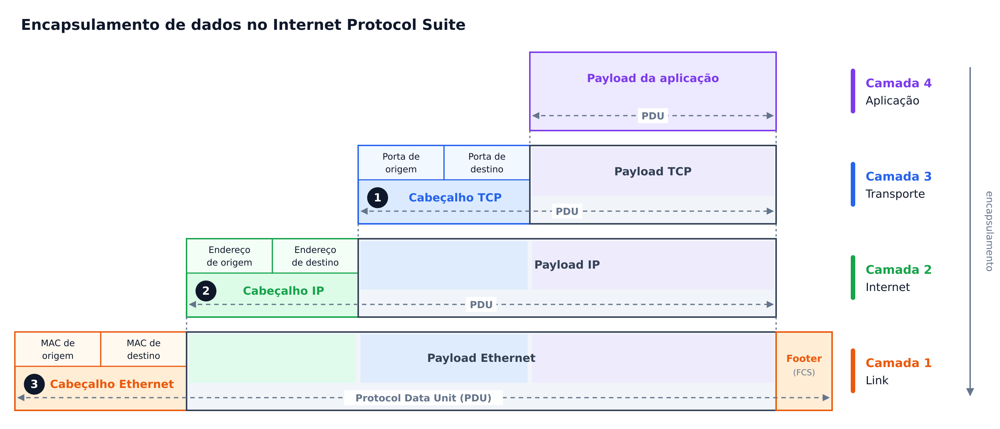
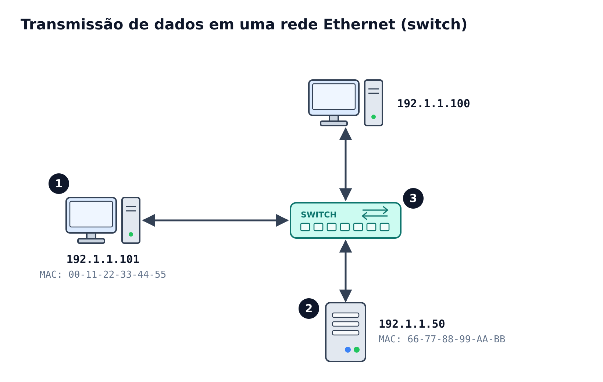
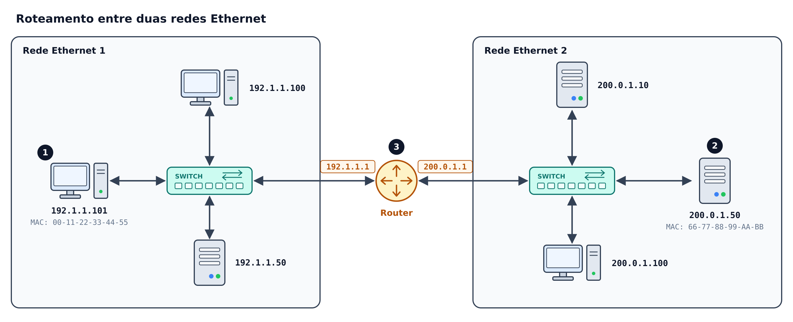

Esta nota reúne os fundamentos de como máquinas conversam numa rede, partindo da ideia de **nó** e **protocolo** até o **roteamento** entre redes distintas. O fio condutor é a stack **TCP/IP**: como os dados sobem e descem pelas 4 camadas via **encapsulamento** (PDU), e como esse pacote encontra seu destino — primeiro dentro da mesma rede Ethernet (switch + ARP + MAC), depois atravessando o **router** via **default gateway** quando o destino está em outra rede. Cada seção acompanha um diagrama.

## Conteúdo

- [Protocolos, funções e a stack TCP/IP](#stack-TCP/IP)
- [Interação entre camadas](#interacao-entre-camadas)
- [Componentes de uma aplicação](#componentes-de-uma-apliacacao)
- [Encapsulamento de dados](#encapsulamento-de-dados) — [Headers, Footers e Endereços](#headers-footers-e-enderecos)
- [Transmissão de dados](#transmissao-de-dados)
- [Roteamento de Rede](#roteamento-de-rede)

---

## stack TCP/IP

Uma rede eh um conjunto de duas ou mais maquinas conectadas que compartilham informacao. Cada maquina conectada, pode ser chamada de nos.

Na imagem acima cada no possui um hardware e sofware diferente. Entretanto, eh possivel observar que todos estao conectados numa mesma rede, isso acontece devido ao protocolo de rede ser algo em comum entre todos os nos. Especificando qual eh o estado necessario para a comunicacao entre as partes.

Um protocolo de rede possui muitas funcoes, dentre elas:
- Manter Conexoes - implementar mecanismos para estabelecer/terminar comunicacoes.
- Identificar os nos - implementar mecanismo de enderecamento de cada no, para garantir que mensagens chegem ao local certo.
- controle de banda - implementar mecanismos para diminuicao de latencia, como tambem gerenciamento de dados.
- Garantir a ordem que os dados sao transmitidos - um protocolo pode reorganizar os dados transmitidos atraves da rede para garantir a integridade da informacao.
- Detectar corrupcao de dados e corrigir erros - muitas redes nao sao 100% confiaveis na entrega da informacao, sendo assim, um protocolo consegue identificar erros e corrigi-los.
- formatacao e encoding de dados - Um dado pode nao estar formatado corretamente para transmissao entre uma rede, um protocolo age nessa barreira. Re-formatando os dados.

Stack to protocolo de Redes

TCP/IP e o protocolo padrao que redes modernas usam. Sendo a conjuncao do protocolo TCP (Transmission Control Protocol) com o protocolo IP (Internet Protocol). Estes dois protocolos formam parte do IPS (Internet Protocol Suite). Um modelo conceitual que forma a internet em 4 camadas, listadas abaixo:
- Camada de Link -> Tambem chamada de camada fisica de rede, ou seja, a camada que conversa diretamente com os dispositivos de hardware de rede do sistema, como modem e roteadores. Seus protocolos incluem, Ethernet (conexoes cabeadas e wireless) e PPP (Point-to-Point Protocol).
- Camada de Internet -> Providencia mecanismos de enderecamento de nos de internet atraves do endereco IP. Os protolos usados nessa camada sao o IPv4 ou Ipv6.
- Camada de Transporte -> Camada responsavel entre conexoes entre cliente e servidor. Geralmente providencia a forma correta de ordem dos bytes ou um multiplexador, sendo este que permite que um unico no consiga conversar com diversos tipos de servicoes diferentes atraves das chamadas "portas".
- Camada de Aplicacao -> Essa camada contem os protocolos de rede que sao HTTP (HyperText Transport Protocol), o qual transfere texto em conteudo legivel nos browsers, SMTP (Simple Mail Transport Protocol), o qual transfere emails e Domain Name System (DNS) protocolo, o qual converte um nome legivel (ex: google.com) no endereco IP usado pela camada 2. O caminho inverso, IP -> nome, eh chamado de DNS reverso.

## Interacao entre camadas
Cada camada so conversa diretamente com o que esta acima e abaixo dela, inclusive as camadas que estao nas pontas. A camada 1 - tambem chamada de camada fisica - alem de conversar com a camada 2, tambem conversa com os impulsos eletricos que chegam atraves do cabo de rede e a funcao modens eh converter esses impulsos em binarios 0e1s para, depois, transforma-los em dados legiveis por nos humanos. Ja a camada de aplicacao, alem de conversar com a camada abaixo dela (TCP IP) tambem conversa com o usuario que esta ativamente mexendo na aplicacao web, email, browser ou ate mesmo outra aplicacao que consome aquele tipo de informacao...

## Componentes de uma apliacacao
Geralmente uma aplicacao possui 3 componentes, sendo eles:
- Comunicacao entre a rede - esta e feita atraves de protocolos como o HTTP para websites e SMTP e POP3 para emails.
- Parsers de conteudo - dados transferidos atraves destes protocolos necessitam de um tratamento antes de serem enviados pela rede, entao eh papel dos parsers de pegar esse conteudo e converter para um formato legivel para a comunicacao entre a rede.
- UI - Sendo o local da aplicacao onde o usuario vai interagir e sera possivel inserir os dados.
## Encapsulamento de dados
Para cada dado que viaja pela IPS (Internet Protocol Suite), ele necessita de um encapsulamento para ser transmitido para a camada acima. Esses dados dentro do IPS recebem um nome de Protocol Data Unit (PDU).
### Headers, Footers e Enderecos
Para cada camada, um PDU possui seus headers. De cima para baixo, acontece o que chamamos de encapsulamento, ou seja, ele vai acumulando os dados das ultimas camadas + os novos dados da camada em questao. Algumas camadas tambem possuem footers, que contem dados necessarios para  assegurar a transmissao correta de informacoes. Como a checagem de erros.

TCP header - Contem o multiplexador de portas como o dito anteriormente, este permite a conexoes de diversos servicos em cada uma das 65536 portas disponiveis (numeradas de 0 a 65535). Portas baixas (0-1023) geralmente sao atribuidas a servicos que ficam escutando conexoes de entrada (inbound), como HTTP na 80 e SSH na 22. Portas altas (efemeras) sao atribuidas pelo SO ao cliente quando ele abre uma conexao de saida para um servico externo. Mas nao eh regra, a configuracao das portas pode ser alterada. Uma lista das portas pode ser observada no arquivo /etc/services.
IP header - Possui o IP de destino e IP de origem. Estes pemitem o No saber o local de onde a mensagem veio, como tambem para quem responder.
IPv4 usa enderecos de 32-bit que variam de acordo com a mascara de rede, que veremos mais para frente. Alem disso, tambem eh utilizado nos dias atuais enderecos de 128-bit para conexoes IPv6.
Protocolo Ethernet tambem possui enderecos de destino e origem, este protocolo usa enderecos de 48-bit chamados Media Access Control (MAC) address. Este eh setado na construcao do hardware eletronico. Mas eh possivel altera-lo atraves de tecnicas como MAC spoofing. O PDU completo da camada de link, isto eh, header + payload + footer, eh chamado de frame Ethernet.
## Transmissao de dados

No exemplo acima o computador 01 quer enviar informacoes para o no 02 (192.1.1.50). O intermediario eh o switch (03), que opera na camada de link, entao ele nao enxerga IP, apenas MAC address. O computador 01 ja sabe o IP de destino, mas precisa do MAC do no 02 para montar o frame. Se esse MAC nao estiver no seu ARP cache, o proprio computador 01 envia um ARP Request (ARP - Address Resolution Protocol) em broadcast perguntando "quem tem o 192.1.1.50?". O switch apenas repassa esse broadcast para todas as portas, e somente o no 02 responde, com um ARP Reply contendo seu MAC (66-77-88-99-AA-BB) direto para o computador 01. Com o MAC em maos, o computador 01 monta o frame completo e o envia; o switch, que aprende em qual porta esta cada MAC, entrega o frame apenas na porta do no 02.

## Roteamento de Rede

Para o computador 1 se conetar com o computador que esta em outra rede, acontece os seguintes passos:
- O computador 1 manda o frame encapsulado contendo IP de origem e destino, porta de origem e destino e seu MAC address de origem.
- Como o MAC de destino eh desconhecido devido ao outro computador estar em outra rede, o SO (Sitema Operacional) do computador 01 consulta a tabela de roteamento. 
- Essa tabela diz que o router (03) sabe como chegar no computador da outra rede. Sendo assim, o frame enviado pelo computador 01 eh enviado ao mac address do router para alcancar o computador da rede 2.
- O router ve que o IP nao eh o dele e manda um novo frame, dessa vez, apontando para o local correto. No caso, o endereco do MAC address que o computador 2 possui. So existe um detalhe, caso o MAC adress do computador 02 estiver no ARP Cache do router ele envia o pacote direto. Caso nao esteja ele manda um ARP Request em broadcast para a rede 2 e espera a resposta do ARP Reply pelo computador correto.

Assim acontecem os pulos de roteador para roteador que podem ser visualizados pelo traceroute no linux a fim de conferir quantos saltos sao necessarios para percorrer um frame ate seu destino final.

O default gateway, visto desde os primeiros `ipconfig` que rodamos no windows, é a rota padrão da routing table: o endereço do router da rede local para onde o host envia todo pacote destinado a outra rede. Ele existe porque seria inviável cada máquina conhecer o caminho para todas as redes; ela só precisa saber o próximo salto, e cada router decide o seguinte.
